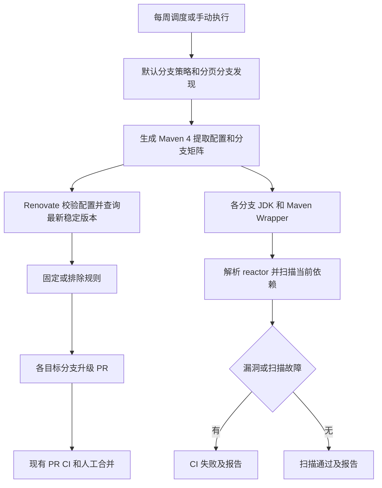

> 2026-10-14 更新：以下内容保留为旧实现记录。当前执行契约、脚本和配置以 `docs/weekly-dependencies.md`、`.github/workflows/weekly-dependencies.yml`、`.github/dependency-policy.json` 与 `scripts/dependencies/check_dependencies.py` 为准；每个分支均保留 CI，读取目标分支策略。下文已退役的 Renovate/旧脚本路径不再作为运行指引。

# 每周跨分支依赖维护

日期：2026-10-14。状态：本地实现，远端运行验收待完成。范围：GitHub CI、依赖策略及维护工具。

## 目标与验收

- 每周一北京时间 10:17 调度，并支持手动执行；使用分页 API 枚举 GitHub 全部分支，包含 backup、feature、fix 及后续新增分支。
- 仅排除本工作流自己创建的 `weekly-deps/` 分支，避免递归维护；超过 GitHub 单矩阵 256 分支限制时报错，不截断。
- 默认分支集中维护策略，无需向历史分支复制配置。Maven 3 使用原生提取，Maven 4.1 模型使用从当前分支 POM 生成的正则提取；未映射的版本属性报错。
- 未固定或排除的 Maven 依赖、BOM、插件按可获取的最新稳定版本提出 PR，允许 major 更新，不设置 PR 数量上限，不自动合并。
- Spring、Jackson 默认保留各分支基线；内部 ddd4j 版本由框架发布维护。规则可配置坐标、通配模式、分支及精确版本约束，后面的规则覆盖前面的规则。
- 每个分支独立执行 OWASP Dependency-Check，覆盖直接、传递、test、provided 依赖；升级排除规则不作为漏洞扫描排除规则。
- CVSS >= 7、依赖解析失败、扫描失败或缺少扫描凭据时 CI 失败。报告保存 30 天，各分支结果与 SHA 写入摘要；一个分支失败不取消其他分支。
- `dry_run` 只禁止更新侧写入，漏洞扫描仍正常执行。

## 流程

## 边界

最新版本不保证没有漏洞，也不保证旧 JDK/API 兼容；PR 需通过构建测试后合并。固定版本约束不会自动把已经超过固定版本的依赖降级。BOM 中由上游管理且本仓库没有覆盖的传递版本，通过更新 BOM 获取；漏洞扫描检查实际解析结果。私有仓库认证与数据库更新依赖仓库 Secrets；缺少运行证据不能称为已启用、漏洞已修复或全部分支扫描通过。

## 验证方法

Node 策略与分支矩阵测试、Python Maven 4 提取测试、全部脚本单测、actionlint、当前 GitHub 分支快照生成检查。上线验收需在默认分支发布配置、提供凭据、先运行 dry_run，检查全部分支扫描报告，再观察实际升级 PR 及其 CI。
